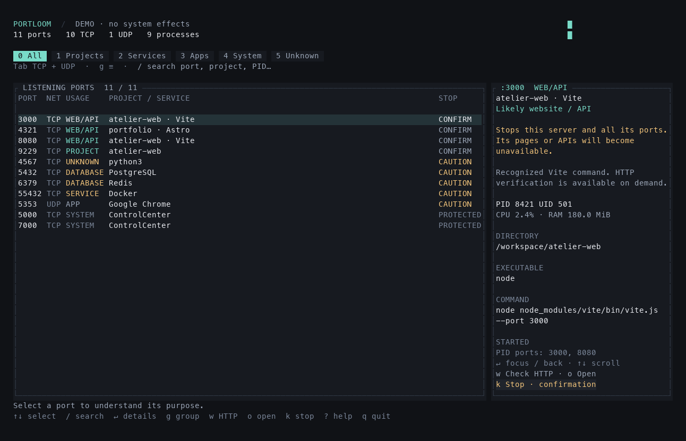
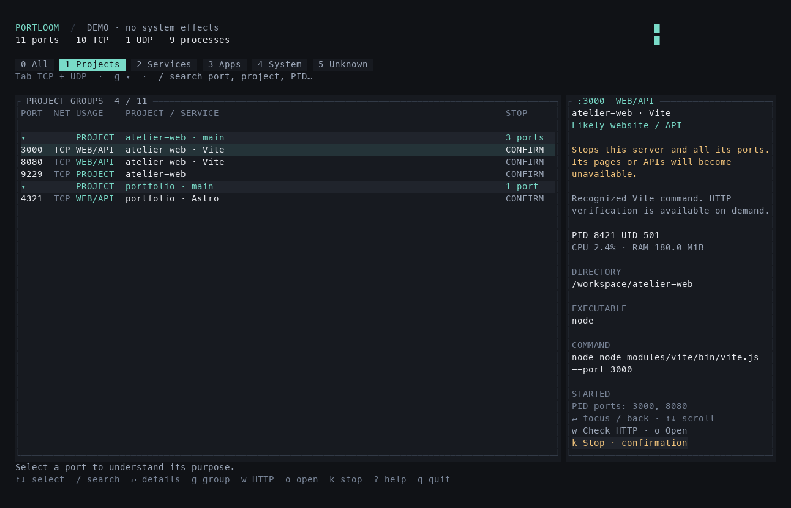

# Portloom

**Your ports, under control.** A native Rust terminal monitor that explains which projects, applications and system services own your ports, and helps you stop the right process.

English · [Français](docs/i18n/README.fr.md)

[](https://github.com/ronael/portloom/actions/workflows/build.yml)
[](LICENSE)



## Install

```sh
npm install --global portloom
portloom
```

The features below require **1.1.0 or later**. Check `npm view portloom version`; if the registry has an older version, download `portloom-1.1.0.tgz` from [GitHub Releases](https://github.com/ronael/portloom/releases) and install it directly:

```sh
npm install --global ./portloom-1.1.0.tgz
```

Native `.tar.gz` downloads also work without npm: extract the archive for your platform and run `./portloom`. The npm launcher uses `exec`; no Node or Bun process stays in memory. There are no install scripts, extra downloads or compilation during installation.

**Platforms:** macOS Apple Silicon/Intel and Linux glibc ARM64/x64. Each release lists the binaries it actually includes. `lsof` and `ps` are required; install `lsof` separately on Linux if needed. Minimum terminal: **60 columns × 20 rows**. Windows, Alpine/musl and HTTPS probing are not supported.

## Language

English is the default. On the first interactive launch, Portloom offers **English / Français**, with a suggested selection based on the terminal locale. Enter saves the choice; Escape continues for this session without saving. The picker is skipped for scripts, JSON, help, completions, demo mode and CI. Installation never prompts.

```sh
portloom --lang fr          # French for this invocation only
portloom language fr        # save French for future launches
portloom language en        # save English
PORTLOOM_LANG=en portloom   # environment override
```

Precedence: **`--lang` → `PORTLOOM_LANG` → saved preference → English**. Press `L` inside the interface to change language. Preferences live in `$XDG_CONFIG_HOME/portloom/settings.json`, falling back to `~/.config/portloom/settings.json`. `PORTLOOM_CONFIG_DIR` overrides the directory with an absolute path. Application messages are translated; operating-system diagnostics and process commands retain their original wording. JSON field names and category identifiers stay stable across languages.

## Explore projects and ports

- TCP listeners and bound UDP sockets, with explicit categories: web/API, project, database, service, app, system or unknown.
- Project groups keyed by their full directory, with the Git branch when available. Press `1` for projects or `g` to toggle grouping; Enter expands or collapses a group. Group headers never stop multiple processes.
- An inspector with command, executable, directory, addresses, CPU, memory and every port owned by the process.
- Search across ports, PIDs, commands, directories and project names. Keyboard and mouse support, scrollable details and JSON output.



## Direct commands

```sh
portloom list --projects
portloom inspect 3000
portloom inspect 3000 --json
portloom stop 3000              # review all affected ports, then confirm
portloom stop 3000 --pid 8421    # choose an owner when a port is shared
portloom watch 3000             # interactive view focused on this port
portloom watch 3000 --json --count 3 --interval 1000
portloom probe 3000             # explicitly verify local HTTP
portloom open 3000              # verify HTTP, then open the browser
portloom --demo                 # simulate without system effects
portloom completions zsh
```

`--demo`, `--lang`, `--json` and `--interval` work before or after subcommands. `inspect`, `stop`, `probe` and `open` accept `--pid` and `--protocol tcp|udp`. An ambiguous action requires a PID. `stop` requires an interactive terminal and refuses piped confirmations and JSON mode. `watch --json` emits one JSON object per line until interrupted or `--count` is reached. The interval is 500–60,000 ms.

## Verify a website

`w` verifies HTTP for the selected port; `o` verifies it and opens its URL. The probe sends **HEAD /** to a numeric loopback address only, with a **2-second network deadline** and **8 KiB header limit**. It sends no credentials or cookies and follows no redirects. The browser is launched only after verification and a fresh identity check. Demo mode never performs network requests or opens a browser.

A valid HTTP response, including 4xx/5xx, confirms the protocol, not application health. The inspector shows the last explicit check. Ports bound only to a LAN address, ambiguous local ownership, UDP and HTTPS-only listeners cannot be verified by this probe. Classification remains evidence-based; a conventional port number alone never proves that something is a website.

## Keyboard

| Key | Action |
| --- | --- |
| `0`–`5` | All / Projects / Services / Apps / System / Unknown |
| `Tab` / `/` | Filter protocol / search |
| `↑↓` / `Enter` | Select / details or expand a project |
| `g` | Toggle project grouping |
| `w` / `o` | Verify HTTP / verify and open |
| `k` / `K` | Prepare SIGTERM / SIGKILL |
| `L` | Change language |
| `Esc` | Cancel or close |
| `Space` / `r` | Pause / refresh |
| `?` / `q` / `Ctrl+C` | Help / quit |

## Deliberate process control

Stopping affects **one process and all its ports**. Portloom displays the impact, then requires `Y` in English (`O` in French) for a project, or the exact PID for sensitive categories. Identity, ownership, classification and newly opened ports are rechecked before sending a signal. System processes, other users' processes, Portloom and its parent terminal are protected.

SIGTERM never escalates automatically to SIGKILL. Children, process groups and containers are not stopped collectively. Identity checking and signal delivery are not atomic; a residual race remains, particularly on macOS where `ps` exposes start times with one-second precision.

No telemetry or sudo escalation. Commands and JSON exports may contain private arguments; review them before sharing. Visibility depends on the current user's permissions.

## Develop

Install rustup, Node 22+, Python 3, `lsof` and `ps`. Rust is pinned in `rust-toolchain.toml`. No `npm install` is needed for development.

```sh
git clone https://github.com/ronael/portloom.git
cd portloom
npm run verify
npm run build
npm run demo
python3 scripts/dev/terminal_smoke.py
python3 scripts/dev/language_smoke.py
npm run pack
node scripts/release/smoke.mjs
```

`npm run install:local` links the compiled binary into `~/.local/bin`. `cargo run --locked --release -- --demo` also works. Captures from `npm run preview`, local archives and build output stay outside Git.

The workspace separates the pure domain (`crates/domain`), use cases and injectable ports (`crates/application`), system adapters (`src/infrastructure`), CLI/TUI (`src/presentation`) and composition (`src/composition`). Translated wording belongs to presentation; protection rules do not depend on language. CI checks dependency boundaries, a maximum of ten source files directly per directory, formatting, Clippy, tests, terminal restoration and installation on four native platforms.

See [architecture](docs/architecture/architecture.md), [design decisions](docs/architecture/decisions.md), [contributing](.github/CONTRIBUTING.md) and [distribution](docs/distribution/npm.md).

## Support and license

Created by [ronael](https://github.com/ronael), npm [ronaeld](https://www.npmjs.com/~ronaeld). Use [GitHub issues](https://github.com/ronael/portloom/issues) for bugs and suggestions, and [private vulnerability reporting](https://github.com/ronael/portloom/security/advisories/new) for security concerns.

Released under the [MIT license](LICENSE). Archives include dependency notices; the npm package also includes the Rust sources and tests.
