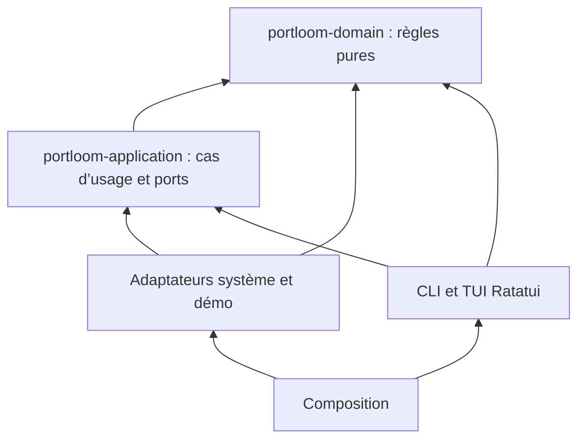

# Architecture

Le projet est un workspace de trois crates. `portloom-domain` contient les modèles, la classification et la politique d’arrêt. `portloom-application` définit les ports et le cas d’usage `StopProcess`. La crate racine `portloom` contient les adaptateurs, les présentations et la composition.

Les flèches indiquent les dépendances de code. Cargo empêche le cœur de dépendre de la crate exécutable ou d’un framework absent de son manifeste. Le domaine dépend seulement de `regex`, une bibliothèque de calcul sans accès système dans son usage ici. L’application dépend seulement du domaine. Les modules de présentation et d’infrastructure restent dans la crate exécutable ; une règle CI interdit leur dépendance mutuelle. Les isoler davantage n’apporterait pas de frontière métier supplémentaire à ce stade.

## Responsabilités et injection

| Contrat | Responsabilité | Implémentations |
| --- | --- | --- |
| `PortScanner` | Lire un relevé de ports | `LocalScanner`, `DemoSystem`, doubles de test |
| `ProcessControl` | Inspecter un processus et envoyer un signal individuel | `LocalControl`, `DemoSystem`, doubles de test |
| `Clock` | Mesurer le temps et espacer les vérifications | Horloge monotone locale, horloge de test |

`StopProcess` reçoit ces contrats et l’identité de l’acteur par son constructeur. La composition choisit les implémentations. Les adaptateurs ne choisissent pas les règles métier ; les widgets ne lancent pas de commandes système. Le JSON est un format de présentation, séparé des modèles métier.

Ce découpage applique SOLID à des frontières concrètes : responsabilité limitée par module, ajout d’adaptateurs via des traits, mêmes contrats pour les implémentations réelles et simulées, interfaces séparées pour lecture/commande/temps, dépendances dirigées vers les ports. Il n’ajoute ni conteneur d’injection, ni interface par structure, ni couche sans comportement.

## Arrêt d’un processus

`prepare` relit l’identité et regroupe tous les ports du propriétaire. `execute` vérifie la propriété, la classification, la confirmation et les nouveaux ports, puis relit le processus avant un signal individuel. Le polling retourne arrêté, disparu ou encore présent après 1,5 s, sans escalade. L’horloge monotone évite les effets d’un changement d’heure système ; son remplacement en test évite les attentes réelles. Les zombies sont omis par le parseur `ps`.

## Lecture du système

Le scanner utilise `lsof` pour TCP/UDP et les dossiers courants, puis `ps` pour les identités et exécutables. Aucun shell : les arguments sont transmis séparément. Les sorties sont limitées à 8 Mio par flux et les commandes à 4 s. IPv4/IPv6 sont regroupés par protocole/port/PID ; le côté local des sockets UDP connectés est conservé. L’UID est recoupé entre les outils. Linux complète le chemin exécutable via `/proc/PID/exe`.

La recherche de projet s’arrête après cinq ancêtres, exclut le dossier personnel, les dépendances et les dossiers de support applicatif, et lit au plus 128 Kio de `package.json`. Le cache est limité à 256 entrées et 30 s. Un dossier inaccessible réduit les indices disponibles.

## Interface et cycle de vie

Un worker traite les scans et les arrêts sur un canal. Une seule opération système est active ; les entrées clavier restent disponibles. Aucun nouveau scan pendant une confirmation. Ratatui dessine après un changement ; la boucle attend les événements. Les dernières données restent visibles avec leur état d’erreur si un relevé échoue.

Un garde RAII restaure le terminal après une sortie, une erreur ou une panique déroulée. SIGINT, SIGTERM et SIGHUP déclenchent la sortie de boucle. SIGKILL ne peut pas être intercepté. Les règles de rendu, couleurs sémantiques et traitement Unicode sont centralisés dans `src/presentation/design.rs`.

## Vérification et limites

`npm run verify` contrôle le graphe Cargo, les frontières source, dix fichiers maximum par dossier, rustfmt, Clippy et tous les tests Rust/Node. La vérification des imports est volontairement conservatrice ; elle ne remplace pas le compilateur. La CI ajoute la restauration réelle d’un pseudo-terminal et l’installation de l’archive npm sur chaque cible native. Les fixtures réseau sont créées et nettoyées par les tests ; aucun service de l’utilisateur n’est arrêté.

`lsof` et `ps` représentent une part du coût d’un relevé. Aucun gain chiffré de performance n’est revendiqué sans mesure. Le contrôle d’identité puis le signal ne sont pas atomiques ; les superviseurs peuvent relancer un processus. La classification d’un site reste indicative. Windows et musl ne sont pas pris en charge.
