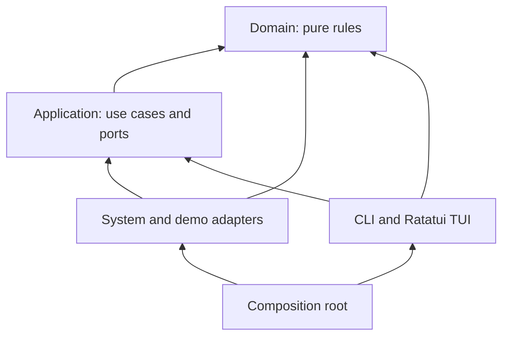

# Architecture

Portloom is a three-crate workspace. `portloom-domain` owns models, classification, typed reasons and stop policy. `portloom-application` defines use cases and their ports. The root crate contains infrastructure, presentation and the composition root.

Arrows show code dependencies. Cargo prevents the core from depending on the executable crate or UI frameworks. The domain only depends on `regex`, used for pure classification; application only depends on domain. CI forbids dependencies between presentation and infrastructure, and direct system access in the core.

## Ports and responsibilities

| Contract | Responsibility | Implementations |
| --- | --- | --- |
| `PortScanner` | Read a port snapshot | Local scanner, demo, test doubles |
| `ProcessControl` | Inspect identity and signal one process | Local control, demo, test doubles |
| `Clock` | Monotonic stop deadlines and polling | System clock, deterministic test clock |
| `HttpProbe` | Verify a constrained local HTTP target | Bounded TCP adapter, demo, test doubles |
| `BrowserOpener` | Open a verified local URL | Platform command adapter, demo, test doubles |
| `PreferencesStore` | Load/save language preferences | Atomic JSON file adapter, test doubles |

Constructors receive these contracts; composition chooses implementations. Widgets never execute system commands. JSON is a presentation format, separate from domain models. SOLID is applied at these behavioral boundaries without an injection container or an interface for every structure.

## Process stops

`StopProcess.prepare` refreshes identity and includes every port owned by the process. `execute` rechecks ownership, classification, PID confirmation and new ports, then inspects identity immediately before signalling. Polling returns stopped, gone or still running after 1.5 seconds, without escalation. System processes, other users, Portloom and its parent are protected.

Presentation obtains explicit confirmation: `Y` in English, `O` in French, or the exact PID for sensitive categories. Direct `stop` rejects piped input, redirected output and JSON before scanning. Project headers cannot initiate collective stops. Identity checks and signalling remain separate OS operations, with a residual race; macOS start times have one-second precision.

## Queries and project groups

`PortQuery` filters ports, protocols, owners and project workloads. Mutating or HTTP actions reject ambiguous owners unless a PID selects one. `ProjectGroup` keys by the full directory; identical project names in different directories remain separate. Shared services are not absorbed into project groups.

Presentation owns collapsed state and stable selection keys. Search temporarily reveals matching children. A refresh reconciles selection by identity rather than using a potentially stale row index. Git branch discovery reads bounded HEAD files, including worktree pointers, without spawning Git.

## HTTP verification

`HttpTarget` can only be constructed from TCP endpoints with numeric loopback addresses or wildcard bindings mapped to loopback. `WebService` refreshes the owner, excludes targets with competing owners, and invokes the HTTP port. Before opening the browser, it refreshes identity and target availability again.

The adapter sends HEAD /, with a total two-second network deadline and an 8 KiB header bound. It does not resolve DNS, follow redirects, send credentials or negotiate TLS. A valid HTTP/1.x status from 200 to 599 confirms the protocol, not application health. Browser opening uses a separately bounded `open`/`xdg-open` command with an argument vector, never a shell. Demo adapters perform no network or browser actions. No background HTTP probing occurs.

## Language and preferences

The domain emits typed `Issue` and `Evidence` values. Presentation translates them through an exhaustive English/French catalog. Tests compare interpolation fields across translations. JSON identifiers remain stable, while display labels follow the selected language; raw OS diagnostics keep their original wording.

Resolution is explicit flag, environment override, saved preference, then English. Terminal locale only suggests the first interactive picker selection. Installation, scripts, help, demo and CI never prompt. Only an explicit language command or picker validation writes preferences. File writes preserve unrelated settings, use a private temporary file and replace the destination atomically.

## System scanning and lifecycle

The scanner uses `lsof` for TCP/UDP and directories, then `ps` for identity and executable data. Arguments are passed directly, without a shell. Output is bounded to 8 MiB per stream and commands to four seconds. IPv4/IPv6 records are grouped by protocol/port/PID; connected UDP keeps the local endpoint. UID values are cross-checked. Linux supplements executable paths through `/proc/PID/exe`.

Project discovery visits at most five ancestors, excludes home and dependency/support directories, and reads at most 128 KiB from a package manifest. Git metadata reads are limited to 4 KiB. The cache holds at most 256 entries for 30 seconds. Missing permissions reduce available context.

A worker serializes scans, stops, HTTP and preference writes while keyboard handling remains available. Confirmations suspend scanning. Ratatui redraws after changes; the event loop otherwise waits. A failed refresh leaves the last snapshot visible with a stale-data warning. HTTP results are labeled as the last check and discarded when their endpoint identity or addresses change.

A RAII guard restores the terminal on exit, errors and unwinding panics. SIGINT, SIGTERM and SIGHUP exit the loop; SIGKILL cannot be caught. Visual tokens and Unicode handling live in `presentation/design.rs`.

## Validation and limits

`npm run verify` checks Cargo dependencies, source boundaries, the ten-files-per-directory rule, formatting, Clippy and Rust/Node tests. CI adds real PTY restoration, language onboarding, simulated stop confirmations and archive installation on all four native platforms. Network fixtures are owned and cleaned up by tests; user services are never stopped.

The scanner's external commands contribute to refresh cost. No performance improvement is claimed without measurement. Supervisors may restart stopped processes. Classification is heuristic. Windows, musl and HTTPS probing are not supported.
