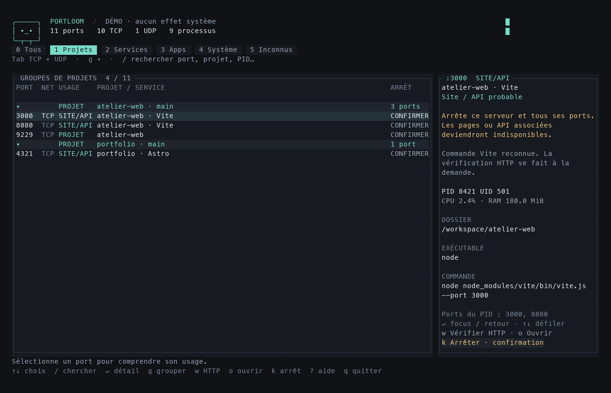

# Portloom

**Tes ports, sous contrôle.** Un moniteur de ports natif en Rust pour comprendre quels projets, applications et services occupent les ports de ta machine, puis arrêter le bon processus.

[English](../../README.md) · Français



## Installer et lancer

```sh
npm install --global portloom
portloom
```

Les fonctions ci-dessous nécessitent **1.1.0 ou plus récent**. Vérifie `npm view portloom version` ; si le registre distribue une version plus ancienne, télécharge `portloom-1.1.0.tgz` dans les [releases GitHub](https://github.com/ronael/portloom/releases), puis installe-la avec `npm install --global ./portloom-1.1.0.tgz`.

Les archives natives `.tar.gz` permettent aussi de lancer `./portloom` sans npm. Aucun processus Node ou Bun ne reste en mémoire ; aucun script, téléchargement supplémentaire ou compilation n’est exécuté à l’installation.

macOS Apple Silicon/Intel et Linux glibc ARM64/x64 sont pris en charge. `lsof` et `ps` sont requis ; `lsof` peut être à installer sous Linux. Terminal minimal : **60 × 20**. Windows, Alpine/musl et la vérification HTTPS ne sont pas pris en charge.

## Choisir la langue

L’anglais est la langue par défaut. Au premier lancement interactif, Portloom propose **English / Français**, avec une sélection suggérée d’après la langue du terminal. Entrée enregistre le choix ; Échap continue pour cette session sans enregistrer. Les scripts, le JSON, l’aide, les complétions, la démo et la CI ne déclenchent pas cette question. L’installation npm reste non interactive.

```sh
portloom --lang fr         # français pour ce lancement seulement
portloom language fr       # enregistrer le français
portloom language en       # enregistrer l’anglais
PORTLOOM_LANG=en portloom  # priorité de la variable d’environnement
```

Priorité : **`--lang` → `PORTLOOM_LANG` → préférence enregistrée → anglais**. La touche `L` ouvre le choix de langue dans l’interface. La préférence est enregistrée dans `$XDG_CONFIG_HOME/portloom/settings.json`, ou `~/.config/portloom/settings.json`. `PORTLOOM_CONFIG_DIR` permet de choisir un dossier absolu. Les messages de l’application sont traduits ; les diagnostics du système et les commandes des processus conservent leur texte d’origine. Les clés JSON et identifiants de catégories restent stables.

## Projets, sites et commandes

**Pip**, la petite mascotte en forme de prise réseau, accompagne l’en-tête. Son expression suit les relevés, la pause, la recherche et les confirmations, dans les trois lignes déjà réservées à l’en-tête.

La touche `1` affiche les projets regroupés ; `g` active ou désactive le regroupement dans les autres vues. Entrée déplie ou replie un projet. Le regroupement utilise son dossier complet et affiche la branche Git lorsqu’elle est disponible. Une ligne de groupe ne déclenche jamais un arrêt collectif.

```sh
portloom list --projects
portloom inspect 3000
portloom inspect 3000 --json
portloom stop 3000              # vérification de tous les ports et confirmation
portloom stop 3000 --pid 8421    # choisir un propriétaire si le port est partagé
portloom watch 3000
portloom watch 3000 --json --count 3 --interval 1000
portloom probe 3000             # vérifier HTTP à la demande
portloom open 3000              # vérifier HTTP puis ouvrir le navigateur
portloom --demo
portloom completions zsh
```

`inspect`, `stop`, `probe` et `open` acceptent `--pid` et `--protocol tcp|udp`. Une action ambiguë exige un PID. `stop` exige un terminal interactif et refuse les confirmations envoyées par un pipe ainsi que le mode JSON. `watch --json` produit un objet JSON par ligne jusqu’à interruption ou jusqu’au nombre demandé par `--count`. L’intervalle est compris entre 500 et 60 000 ms.

`w` vérifie HTTP sur le port sélectionné ; `o` vérifie puis ouvre son URL. La sonde utilise **HEAD /** sur une adresse numérique de boucle locale, avec un délai réseau total de **2 secondes** et des en-têtes limités à **8 Kio**. Elle n’envoie ni identifiant ni cookie et ne suit pas les redirections. La démo n’effectue aucun appel réseau et n’ouvre aucun navigateur.

Une réponse HTTP valide, même 4xx/5xx, confirme le protocole, pas la santé de l’application. L’inspecteur affiche la dernière vérification explicite. Les ports uniquement accessibles sur le réseau local, les propriétaires HTTP ambigus, UDP et HTTPS ne sont pas vérifiés par cette sonde.

| Touche | Action |
| --- | --- |
| `0` à `5` | Tous / Projets / Services / Apps / Système / Inconnus |
| `Tab` / `/` | Filtrer le protocole / rechercher |
| `↑↓` / `Entrée` | Sélectionner / détail ou déplier un projet |
| `g` / `w` / `o` | Grouper / vérifier HTTP / vérifier et ouvrir |
| `k` / `K` | Préparer SIGTERM / SIGKILL |
| `L` | Choisir la langue |
| `Échap` / `Espace` / `r` | Annuler / pause / actualiser |
| `?` / `q` / `Ctrl+C` | Aide / quitter |

## Arrêter en connaissance de cause

Un arrêt vise **un processus et tous ses ports**. Confirmer avec `O` en français (`Y` en anglais) pour un projet ; saisir le PID exact pour les catégories sensibles. L’identité, la propriété, la classification et les nouveaux ports sont revérifiés avant le signal. Les processus système, ceux d’autres utilisateurs, Portloom et son terminal sont protégés. SIGTERM ne devient jamais automatiquement SIGKILL.

La vérification d’identité et l’envoi du signal ne sont pas atomiques ; une course résiduelle reste possible, notamment sous macOS où l’heure de démarrage est exposée à la seconde. Les catégories reposent sur des indices : un numéro de port ne suffit pas à prouver qu’il s’agit d’un site.

Aucune télémétrie ni élévation sudo. Les commandes et exports peuvent contenir des informations privées ; relis-les avant partage.

## Développement, support et licence

Rust est fixé par `rust-toolchain.toml`. Node 22+, Python 3, `lsof` et `ps` sont nécessaires aux scripts et tests. Aucun `npm install` requis : `npm run verify`, `npm run build`, puis `npm run demo`. Les détails de l’architecture et de la contribution se trouvent dans le [README anglais](../../README.md#develop).

Les [issues GitHub](https://github.com/ronael/portloom/issues) accueillent les bugs et propositions. Pour une vulnérabilité, utilise le [signalement privé](https://github.com/ronael/portloom/security/advisories/new).

Portloom est sous [licence MIT](../../LICENSE). Les notices de dépendances sont incluses dans les archives, ainsi que les sources et tests Rust dans le paquet npm.
